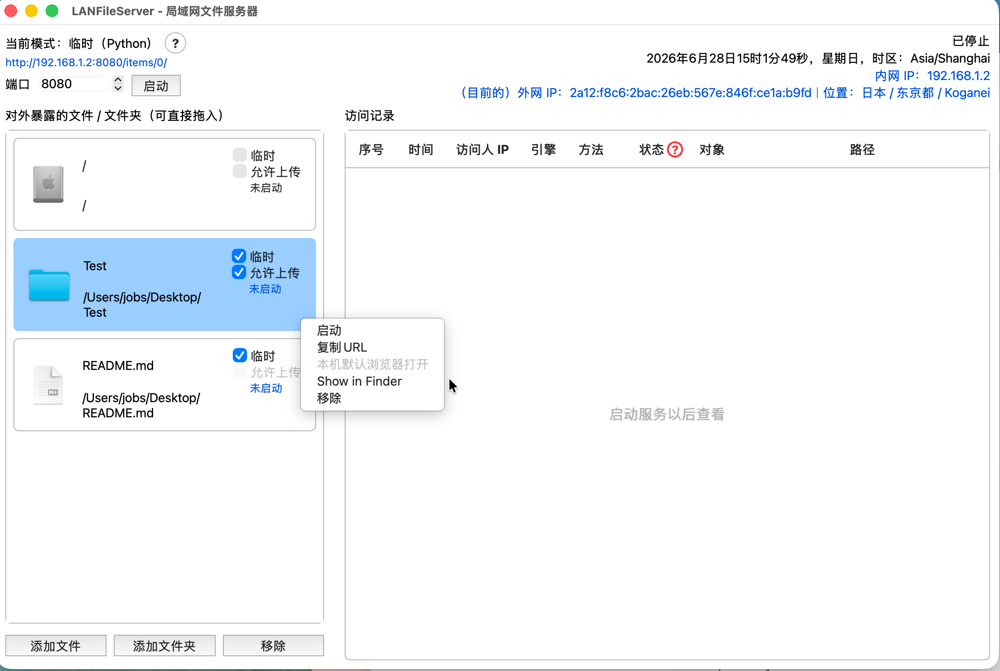
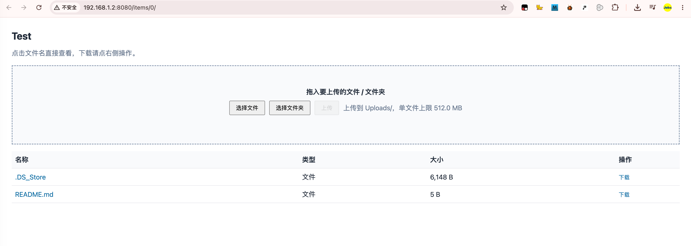

# `LANFileServer`


<!-- jobs-toc:start -->
<!-- jobs-toc:source {"v":2,"token":"[toc]"} -->
<details>
<summary>📚 目录（点击展开 / 收起）</summary>

- [🔥 前言](#jobs-toc-heading-1)
- [一、目录结构](#jobs-toc-heading-2)
- [二、运行方式](#jobs-toc-heading-3)
  - [【MacOS】📦生成dmg.command](#jobs-toc-heading-4)
  - [【Windows】📦生成exe.bat](#jobs-toc-heading-5)
- [三、使用说明](#jobs-toc-heading-6)
- [四、日志与产物](#jobs-toc-heading-7)
- [五、风险说明](#jobs-toc-heading-8)
- [六、常见问题](#jobs-toc-heading-9)
  - [6.1、双击外层脚本提示找不到项目启动器](#jobs-toc-heading-10)
  - [6.2、macOS 提示脚本没有执行权限](#jobs-toc-heading-11)
  - [6.3、端口被占用](#jobs-toc-heading-12)
  - [6.4、同一局域网其它设备打不开地址](#jobs-toc-heading-13)
  - [6.5、上传的文件在哪里](#jobs-toc-heading-14)
- [七、Mac Python 环境自检](#jobs-toc-heading-15)
- [八、本仓目录与脚本入口](#repository-layout-and-entrypoints)
  - [启动LANFileServer.command](#jobs-toc-heading-17)
  - [启动LANFileServer.bat](#jobs-toc-heading-18)

</details>
<!-- jobs-toc:end -->

---

## <span id="jobs-toc-heading-1" data-jobs-toc="v2">🔥 <font id=前言>前言</font></span><!-- jobs-toc:heading-end -->






## <span id="jobs-toc-heading-2" data-jobs-toc="v2">一、目录结构 <a href="#前言" style="font-size:17px; color:green;"><b>🔼</b></a> <a href="#🔚" style="font-size:17px; color:green;"><b>🔽</b></a></span><!-- jobs-toc:heading-end -->

```text
.
├── README.md
├── 【MacOS】📦生成dmg.command
├── 【Windows】📦生成exe.bat
├── dist/YYYY.MM.DD HH-mm-ss/LANFileServer-macOS-<本机架构>.dmg
└── LANFileServer/
    ├── LANFileServer.py
    ├── pyproject.toml
    ├── lanfileserver/
    │   ├── models.py
    │   ├── network.py
    │   ├── servers.py
    │   ├── ui.py
    │   └── web.py
    ├── tests/
    │   └── test_transfer.py
    ├── README.md
    ├── requirements.txt
    ├── requirements-build.txt
    ├── 启动LANFileServer.command
    └── 启动LANFileServer.bat
```

- `./README.md`：当前外层目录说明。
- `./【MacOS】📦生成dmg.command`：macOS 外层入口，双击后转交给 `./LANFileServer/启动LANFileServer.command`，并生成 `./dist/YYYY.MM.DD HH-mm-ss/LANFileServer-macOS-<本机架构>.dmg`。
- `./【Windows】📦生成exe.bat`：Windows 外层入口，双击后转交给 `./LANFileServer/启动LANFileServer.bat`。
- `./dist/YYYY.MM.DD HH-mm-ss/LANFileServer-macOS-<本机架构>.dmg`：macOS 可分发安装包，按构建机的 Intel 或 Apple Silicon 架构生成。
- `./LANFileServer/`：内部项目目录，保存源码、依赖、构建脚本和项目级 README；`.app` 与安装包保存到外层时间目录。

## <span id="jobs-toc-heading-3" data-jobs-toc="v2">二、运行方式 <a href="#前言" style="font-size:17px; color:green;"><b>🔼</b></a> <a href="#🔚" style="font-size:17px; color:green;"><b>🔽</b></a></span><!-- jobs-toc:heading-end -->

### <span id="jobs-toc-heading-4" data-jobs-toc="v2">[【MacOS】📦生成dmg.command](./【MacOS】📦生成dmg.command)</span><!-- jobs-toc:heading-end -->

> **目的：** 从外层目录一键生成 LANFileServer 的 macOS APP / DMG。

* 显示用途，按脚本位置查找内层 `启动LANFileServer.command` 并检查执行权限。
  * 启动器缺失或不可执行：报告路径并停止。
* 以 `build-dmg` 参数调用内层启动器，将输出目录指定为本仓外层。
* 内层完成环境确认、旧产物清理、APP / DMG 生成及成品启动，外层返回其结果。


- 双击外层脚本：

  ```text
  ./【MacOS】📦生成dmg.command
  ```

- 外层脚本会自动寻找内部项目启动器：

  ```text
  ./LANFileServer/启动LANFileServer.command
  ```

- 内部启动器会准备 Homebrew 管理的本机架构构建环境、安装或复用依赖、打包 `.app`，最后在外层目录生成：

  ```text
  ./dist/YYYY.MM.DD HH-mm-ss/LANFileServer-macOS-<本机架构>.dmg
  ```

- 黑色终端窗口是打包窗口。看到 `DMG 已生成` 后，可以关闭这个窗口。
- `.dmg` 可以直接打开运行里面的 App，也可以把 App 拖入系统 `Applications` 文件夹。

### <span id="jobs-toc-heading-5" data-jobs-toc="v2">[【Windows】📦生成exe.bat](./【Windows】📦生成exe.bat)</span><!-- jobs-toc:heading-end -->

> **目的：** 从外层目录生成 LANFileServer 的 Windows EXE。

* 按脚本位置定位 `LANFileServer/启动LANFileServer.bat`。
  * 找不到启动器：显示错误并停止。
* 以 `build-exe` 参数转交内层启动器，由它准备依赖并清理外层旧 `dist/`。
* 构建成功后打开目录并启动新 EXE，外层返回相同退出码。


- 双击外层脚本：

  ```text
  ./【Windows】📦生成exe.bat
  ```

- 外层脚本会转交给内部项目启动器：

  ```text
  ./LANFileServer/启动LANFileServer.bat
  ```

- 内部启动器会创建或复用 `.venv`、安装缺失依赖，然后启动图形界面。

## <span id="jobs-toc-heading-6" data-jobs-toc="v2">三、使用说明 <a href="#前言" style="font-size:17px; color:green;"><b>🔼</b></a> <a href="#🔚" style="font-size:17px; color:green;"><b>🔽</b></a></span><!-- jobs-toc:heading-end -->

1. 打开 `LANFileServer`。
2. 把要暴露给局域网其它设备访问的文件或文件夹拖入左侧列表。
3. 每个项目都可以单独选择“临时（Python）”或“非临时（Nginx）”。
4. 文件夹项目可以按需勾选“允许上传”；对方浏览器上传的文件只会写入该共享文件夹下的 `Uploads/` 子目录。
5. 选中左侧项目，点击顶部启动按钮。
6. 把顶部蓝色访问地址发送给同一局域网内的其它电脑或手机。
7. 右侧访问记录会显示访问时间、访问人 IP、服务引擎、状态码、对象和路径。

- 浏览器目录页里点击文件名或文件夹名默认查看；需要下载时点击右侧“下载”。
- 文件下载直接返回原文件，支持 HTTP `Range`、断点续传和音视频拖动；只有文件夹下载才会生成 `主体名.zip`。
- 允许上传的目录页会显示上传区，支持拖入文件 / 文件夹，也支持点“选择文件”“选择文件夹”后再点“上传”。
- 拖入文件 / 文件夹后会先进入待上传队列，页面会弹窗询问是否现在上传；取消后不会立刻写入本机，仍可稍后手动点“上传”。
- 上传按 `1 MB` 分块流式写盘，不设置应用层固定大小上限，实际大小受目标磁盘剩余空间限制；上传前会预留安全空间，文件夹上传会保留相对目录结构，同名文件自动改名。
- 浏览器页面支持响应式桌面/手机布局、目录搜索、粘贴截图、文件夹递归拖放、上传进度、实时速度和系统分享菜单。
- 浏览器顶部支持显式复制当前链接和显示二维码；二维码由本机生成，不会把局域网访问地址提交给第三方二维码服务。
- 每个共享项目都有独立的局域网聊天室，支持昵称、回车发送和每 `3` 秒增量刷新，服务运行期间保留最近 `200` 条消息。
- 文件列表支持名称、最近修改时间和文件大小排序，图片文件直接显示缩略图；点击图片后可使用“缩小 / 放大”按钮按 `25%` 调整显示比例，并使用页面按钮或键盘 `←` / `→` 翻阅同一目录内的图片。
- `HEIC` / `HEIF` 会转换成浏览器可显示的 JPEG 预览流，图片详情页直接承担预览，只保留“下载原文件”按钮用于下载原始图片。
- 开启“允许上传”后，浏览器可以删除当前项目 `Uploads/` 目录内的普通文件；删除前必须二次确认，不能删除原始共享文件、目录或符号链接。
- 左侧项目支持右键菜单，可以执行启动 / 停止、复制 URL、本机默认浏览器打开、Show in Finder、移除。
- 左侧项目支持长按拖动排序，拖动时会像 SourceTree 列表一样实时让位。
- 右侧访问记录区域支持右键菜单，可以清除当前记录。
- 没有启动服务且没有访问记录时，右侧访问记录区域会显示 `启动服务以后查看`。
- 如果关闭窗口时仍有服务运行，程序会询问是否最小化到任务栏继续运行。

## <span id="jobs-toc-heading-7" data-jobs-toc="v2">四、日志与产物 <a href="#前言" style="font-size:17px; color:green;"><b>🔼</b></a> <a href="#🔚" style="font-size:17px; color:green;"><b>🔽</b></a></span><!-- jobs-toc:heading-end -->

| 内容 | 文件或位置 |
| --- | --- |
| macOS 外层脚本日志 | 系统临时目录中的 `【MacOS】📦生成dmg-desktop.log` |
| macOS 内部构建日志 | 系统临时目录中的 `启动LANFileServer.log` |
| macOS DMG | `./dist/YYYY.MM.DD HH-mm-ss/LANFileServer-macOS-<本机架构>.dmg` |
| macOS App 产物 | `./dist/YYYY.MM.DD HH-mm-ss/LANFileServer.app` |
| 内部项目说明 | `./LANFileServer/README.md` |

## <span id="jobs-toc-heading-8" data-jobs-toc="v2">五、风险说明 <a href="#前言" style="font-size:17px; color:green;"><b>🔼</b></a> <a href="#🔚" style="font-size:17px; color:green;"><b>🔽</b></a></span><!-- jobs-toc:heading-end -->

- 这个工具会把左侧列表里的文件 / 文件夹暴露给同一局域网内能访问当前端口的设备。
- 不建议拖入隐私目录、系统目录、浏览器数据目录、密码文件或其它敏感资料。
- “允许上传”只对文件夹项目生效，上传目标固定为共享目录下的 `Uploads/`。开启后，同一局域网内能访问该 URL 的设备都可以向这个子目录写入文件。
- 上传不会覆盖已有同名文件，但仍应只对可信设备开放，并在使用后及时关闭共享或取消“允许上传”。
- 聊天消息只保存在当前服务进程内，不写入磁盘；同一共享项目的访问者可以看到该项目最近的聊天内容。
- 浏览器删除能力严格限制在已开启上传项目的 `Uploads/` 目录内，但删除成功后不可撤销。
- “临时（Python）”由 Python 流式传输并支持 `Range`；“非临时（Nginx）”由 Python 提供页面和上传控制，由 Nginx `alias + sendfile` 直接输出文件字节，适合长期运行、多人访问和大文件下载。
- 只要有项目选择非临时模式，程序会准备并使用本机 [**Nginx**](https://nginx.org/)；macOS 上可能通过 [**Homebrew**](https://brew.sh/) 准备依赖。
- 外网 IP 只是展示当前出口 IP 和大致地理位置，不代表外网设备一定可以访问本机服务；跨公网访问还受路由器、防火墙、运营商网络和端口映射影响。

## <span id="jobs-toc-heading-9" data-jobs-toc="v2">六、常见问题 <a href="#前言" style="font-size:17px; color:green;"><b>🔼</b></a> <a href="#🔚" style="font-size:17px; color:green;"><b>🔽</b></a></span><!-- jobs-toc:heading-end -->

### <span id="jobs-toc-heading-10" data-jobs-toc="v2">6.1、双击外层脚本提示找不到项目启动器 <a href="#前言" style="font-size:17px; color:green;"><b>🔼</b></a> <a href="#🔚" style="font-size:17px; color:green;"><b>🔽</b></a></span><!-- jobs-toc:heading-end -->

确认当前目录里存在：

```text
./LANFileServer/启动LANFileServer.command
```

如果移动了目录，需要保持外层脚本和 `./LANFileServer/` 文件夹在同一个父目录里。

### <span id="jobs-toc-heading-11" data-jobs-toc="v2">6.2、macOS 提示脚本没有执行权限 <a href="#前言" style="font-size:17px; color:green;"><b>🔼</b></a> <a href="#🔚" style="font-size:17px; color:green;"><b>🔽</b></a></span><!-- jobs-toc:heading-end -->

在当前目录打开终端后执行：

```shell
chmod +x ./【MacOS】📦生成dmg.command
chmod +x ./LANFileServer/启动LANFileServer.command
```

### <span id="jobs-toc-heading-12" data-jobs-toc="v2">6.3、端口被占用 <a href="#前言" style="font-size:17px; color:green;"><b>🔼</b></a> <a href="#🔚" style="font-size:17px; color:green;"><b>🔽</b></a></span><!-- jobs-toc:heading-end -->

在界面里换一个端口，或先停止占用当前端口的其它程序。常见可尝试端口包括 `8081`、`8090`、`9000`。

### <span id="jobs-toc-heading-13" data-jobs-toc="v2">6.4、同一局域网其它设备打不开地址 <a href="#前言" style="font-size:17px; color:green;"><b>🔼</b></a> <a href="#🔚" style="font-size:17px; color:green;"><b>🔽</b></a></span><!-- jobs-toc:heading-end -->

检查几件事：

1. 对方设备和本机是否在同一个局域网。
2. 本机防火墙是否拦截当前端口。
3. 发送给对方的是否是蓝色项目地址，而不是只到端口首页的地址。
4. 服务是否已经启动，左侧项目是否显示已启动。

### <span id="jobs-toc-heading-14" data-jobs-toc="v2">6.5、上传的文件在哪里 <a href="#前言" style="font-size:17px; color:green;"><b>🔼</b></a> <a href="#🔚" style="font-size:17px; color:green;"><b>🔽</b></a></span><!-- jobs-toc:heading-end -->

上传文件固定进入对应共享文件夹里的：

```text
Uploads/
```

如果同名文件已经存在，程序会自动改成 `文件名 (1).扩展名` 这类形式。

如果上传的是文件夹，文件夹内的相对层级会保留在 `Uploads/` 下面。

打包前会清理该应用工程的旧 `dist` 产物，清理失败则停止；成功后自动打开当前平台产物的磁盘位置并运行本次生成的 APP / EXE，结尾无需回车。失败时不启动软件；运行前的防误触确认保留。

必需依赖缺失时，直接回车联网安装；输入任意字符后回车取消整个流程。安装失败或复检仍不可用时停止，不继续清理旧产物或打包。健康依赖直接复用；可选升级和词库更新仍为回车跳过、任意字符执行。

第一层交付目录与平台打包脚本同层保存 `dist/`，以及最新 APP / DMG 的相对符号链接（Mac）或 EXE / 分发包的 `.lnk`（Windows）。双击快捷方式即可接触成品，真实文件保留在 `dist/`；成功构建自动更新入口，清理旧产物时移除对应旧入口。尚无成品时不生成无效快捷方式。

构建产物使用本机本地构建时间，格式为 `YYYY.MM.DD HH-mm-ss`（年月日时分秒），例如 `2020.06.04 12-23-21`。每次构建的 APP、DMG、EXE、ZIP 和配套文件统一保存到交付层 `./dist/YYYY.MM.DD HH-mm-ss/`，同次构建只取一次时间；第一层快捷方式指向本次时间目录，成功后打开该目录并启动其中的软件。旧产物沿用原有清理规则；历史产物缺少可靠构建时间时，不补写推测时间。


## <span id="jobs-toc-heading-15" data-jobs-toc="v2">七、Mac Python 环境自检 <a href="#前言" style="font-size:17px; color:green;"><b>🔼</b></a> <a href="#🔚" style="font-size:17px; color:green;"><b>🔽</b></a></span><!-- jobs-toc:heading-end -->

实际使用 Python 的 Mac 入口通过脚本内部的具名函数执行环境自检，完整自检实现随该脚本携带。先阅读自述并确认，再自检 [**Homebrew**](https://brew.sh/)：已有安装执行 `brew update`，只更新自身和配方索引，不全量升级其它软件；缺少时安装并复检。安装路径精确输入 `YES` 选择系统标准目录，其它输入或回车选择用户目录；失败停止，不自动改换路线。新系统缺少 Command Line Tools 时按系统提示完成安装后重试。

[**Python**](https://www.python.org) 使用 Homebrew 配方；实际版本和标准库满足工具要求时复用，不兼容时才安装 / 升级并复检。必需修复直接回车执行，任意非空输入（含空格）、EOF 或非交互缺失环境均停止。旧虚拟环境不兼容时完整改名备份后重建，保留备份。Homebrew 安装路径选择、更新、Python 版本与健康检查均封装在实际执行脚本内部，不依赖外部环境支持库、同步脚本或父仓文件。Windows 入口保持原有平台环境流程；运行已打包成品无需准备构建环境。

## 八、<span id="repository-layout-and-entrypoints">本仓目录与脚本入口</span> <a href="#前言" style="font-size:17px; color:green;"><b>🔼</b></a> <a href="#🔚" style="font-size:17px; color:green;"><b>🔽</b></a>

以下为当前检出的源码与维护入口；依赖环境、Git 元数据、构建缓存和生成产物略去，独立子仓仅列目录。

```text
.
├── .gitignore
├── 【MacOS】📦生成dmg.command
├── 【Windows】📦生成exe.bat
├── assets/
├── icon.png
├── LANFileServer/
│   ├── lanfileserver/
│   ├── LANFileServer.py
│   ├── LANFileServer.spec
│   ├── pyproject.toml
│   ├── README.md
│   ├── requirements-build.txt
│   ├── requirements.txt
│   ├── scripts/
│   ├── tests/
│   ├── 启动LANFileServer.bat
│   └── 启动LANFileServer.command
└── README.md
```

* `LANFileServer/LANFileServer.py` 是源码入口，`lanfileserver/` 保存共享服务与界面模块；`scripts/` 管理产物快捷方式，`tests/` 保存回归用例。

### <span id="jobs-toc-heading-17" data-jobs-toc="v2">[启动LANFileServer.command](./LANFileServer/启动LANFileServer.command)</span><!-- jobs-toc:heading-end -->

> **目的：** 执行 LANFileServer 的 macOS 打包，或用 `run-app` 启动源码界面。

* 显示自述，确认 Homebrew / Python 环境准备，定位内层源码和依赖文件。
* 默认进入 `build-dmg`；创建或复用虚拟环境，检查构建依赖与入口语法。
  * 依赖缺失：回车安装，任意非空输入取消；`run-app` 只准备运行依赖并启动源码。
* 打包模式清理外层旧 `dist/`，优先生成 universal2 APP。
  * 当前 Python 不支持双架构构建：回退本机架构。
* 封装 DMG、更新第一层快捷方式，打开构建时间目录并启动 APP；日志写入系统临时目录。

### <span id="jobs-toc-heading-18" data-jobs-toc="v2">[启动LANFileServer.bat](./LANFileServer/启动LANFileServer.bat)</span><!-- jobs-toc:heading-end -->

> **目的：** 在 Windows 准备 LANFileServer 环境，默认运行界面，按参数生成 EXE。

* 显示自述，查找 Python，检查入口与依赖文件，创建或复用 `.venv/`。
  * Python 缺失时停止；依赖缺失时回车安装，任意非空输入取消。
* 没有 `build-exe` 参数时，检查源码语法并启动界面。
* 传入 `build-exe` 时检查打包依赖，清理外层旧 `dist/`，生成单文件 EXE。
* 构建成功后更新快捷方式、打开产物目录并启动 EXE；失败时暂停显示错误与日志位置。

<a id="🔚" href="#前言" style="font-size:17px; color:green; font-weight:bold;">我是有底线的➤点我回到首页</a>
